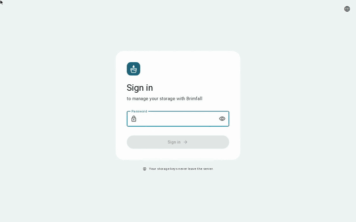
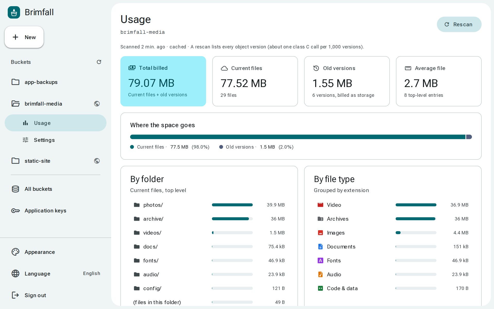
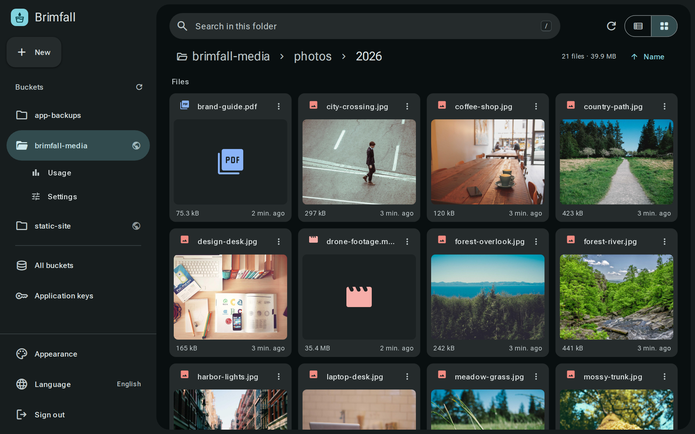

<p align="center">
  
</p>

<h1 align="center">Brimfall</h1>

<p align="center">
  A modern, self-hosted dashboard for Backblaze B2 and S3-compatible storage.<br>
  Material 3 design · 30 languages · one container.
</p>

<p align="center">
  
  <br>
  <sub><a href="docs/demo.mp4">Full-quality video (MP4)</a></sub>
</p>

Brimfall is a web dashboard for your object storage. Browse and manage files the way you would in a file manager, see what is taking up space (including the old versions you're still paying for), and change bucket settings without logging in to your provider's console. It's built for Backblaze B2 and also works as a file manager for any S3-compatible service.

## Features

- **File manager.** Folders, breadcrumbs, list and grid views with thumbnails, sorting, multi-select (Shift/Ctrl), right-click menus and keyboard shortcuts (`/`, `Del`, `Ctrl+A`, `Enter`, `Backspace`, `Esc`).
- **Fast uploads.** Drag and drop files or whole folders. Files go straight from the browser to storage with presigned URLs, and big files are sent in parallel parts. Progress, speed, cancel and retry.
- **Preview.** Images, video, audio, PDF and text/code, with ← → to move between files.
- **Rename, move and copy**, folders included (large files use multipart copy). Brimfall asks before overwriting anything.
- **Delete that frees space.** By default every version is removed so storage is actually freed, or you can just hide a file.
- **Links.** Copy public/CDN URLs for one file or many, or create signed links that expire in 1 hour to 7 days.
- **Details and versions.** Metadata, version history, and restoring, downloading or deleting old versions.
- **Usage.** Total size, file count, **space held by old versions** (billed as storage), and breakdowns by folder and file type, plus the largest and most recent files.
- **Bucket settings** (B2): public/private, CORS (one click to allow uploads from Brimfall, or edit the JSON), lifecycle rules (one click for "keep only the last version"), unfinished large uploads, and creating or deleting buckets.
- **Application keys** (B2): list, create (presets, bucket and prefix limits, expiry) and delete. The secret is shown once.
- **Material 3 dynamic color.** Light/dark/system theme, any accent color, contrast levels and a compact density.
- **30 languages, RTL included.** The UI follows the browser language and can be switched from the menu or the sign-in page.
- **Responsive.** A navigation drawer on desktop, a rail on tablets and a modal drawer with a floating action button on phones.

<p align="center">
  
  
</p>

## Quick start (Docker)

```bash
git clone https://github.com/Anysola/brimfall.git
cd brimfall
cp .env.example .env
# set DASHBOARD_PASSWORD, SESSION_SECRET (openssl rand -base64 48), B2_KEY_ID and B2_APP_KEY
docker compose up -d
```

Brimfall now listens on `http://127.0.0.1:3000`. Put it behind HTTPS (see [Reverse proxy](#reverse-proxy)) before you use it over a network: the session cookie is marked `Secure` on HTTPS, and your storage key deserves an encrypted connection.

Then open **Bucket settings → CORS → Allow uploads from here** for each bucket you want to upload to. Uploads go directly from your browser to storage, so the bucket has to allow Brimfall's address.

### Without Docker

You need Node.js 20.9 or newer.

```bash
npm ci
cp .env.example .env.local   # fill it in
npm run build
cp -r public .next/standalone/ && cp -r .next/static .next/standalone/.next/
cp .env.local .next/standalone/.env   # or export the variables in your service manager
node .next/standalone/server.js       # PORT and HOSTNAME are respected
```

## Configuration

All configuration is done with environment variables. See [`.env.example`](.env.example).

| Variable | Required | Default | Description |
| --- | --- | --- | --- |
| `DASHBOARD_PASSWORD` | yes | none | Password for signing in (single user). Changing it signs everyone out. |
| `SESSION_SECRET` | yes | none | At least 32 characters. Signs the session cookie. Changing it signs everyone out. |
| `B2_KEY_ID`, `B2_APP_KEY` | yes* | none | Backblaze B2 **application key**. The S3 endpoint is discovered automatically. The master key doesn't work, because B2's S3 API rejects it. |
| `DEFAULT_BUCKET` | | first bucket | Bucket opened after signing in. |
| `CDN_URLS` | | none | Public base URL per bucket, comma separated: `bucket=https://cdn.example.com`. Used for copied links, previews and thumbnails. |
| `APP_NAME` | | `Brimfall` | Name shown in the UI and the tab title. |
| `LOGO_URL` | | built-in logo | URL of a square logo (SVG or PNG). |
| `DEFAULT_LOCALE` | | `en` | Language used when the browser's language isn't supported. |
| `SESSION_TTL_HOURS` | | `168` | How long a sign-in lasts. |
| `CLIENT_IP_HEADER` | | last `X-Forwarded-For` hop | Header with the real client IP for sign-in rate limiting (`cf-connecting-ip`, `x-real-ip`). |
| `S3_ENDPOINT`, `S3_REGION`, `S3_ACCESS_KEY_ID`, `S3_SECRET_ACCESS_KEY`, `S3_FORCE_PATH_STYLE` | | none | Use any S3-compatible service instead of B2. *Replaces the B2 key. |

### Key permissions

| To use | Capabilities |
| --- | --- |
| Files | `listBuckets`, `listFiles`, `readFiles`, `writeFiles`, `deleteFiles` |
| Bucket settings | add `readBuckets`, `writeBuckets` (and `deleteBuckets` to delete buckets) |
| Application keys page | add `listKeys`, `writeKeys`, `deleteKeys` |

The simplest setup is an application key with every capability ("Everything" on the keys page). Brimfall won't let you delete the key it runs on.

### Other S3-compatible storage

Set `S3_ENDPOINT`, `S3_ACCESS_KEY_ID` and `S3_SECRET_ACCESS_KEY` to use Brimfall as a file manager for MinIO, Cloudflare R2, Wasabi, RustFS and similar services. Bucket settings and application keys use the B2 native API, so they're hidden in this mode. Version history needs the endpoint to support `ListObjectVersions`.

### Reverse proxy

Large uploads don't pass through Brimfall (they go straight to storage), so the defaults of most proxies are fine.

**Caddy**

```caddy
storage.example.com {
  reverse_proxy 127.0.0.1:3000
}
```

**nginx**

```nginx
location / {
  proxy_pass http://127.0.0.1:3000;
  proxy_set_header Host $host;
  proxy_set_header X-Real-IP $remote_addr;
  proxy_set_header X-Forwarded-For $proxy_add_x_forwarded_for;
  proxy_set_header X-Forwarded-Proto $scheme;
}
```

Set `CLIENT_IP_HEADER=x-real-ip` (nginx) or `cf-connecting-ip` (Cloudflare) so rate limiting sees real client addresses. Because Brimfall controls your whole storage account, consider an extra layer such as Cloudflare Access or your proxy's basic auth.

## How it works and security

- **Keys stay on the server.** The browser never sees your storage key. Uploads, downloads, previews and thumbnails use short-lived presigned URLs, and public files use your CDN URL.
- **Sessions** are HMAC-signed, `HttpOnly` cookies. Signing out revokes the session on the server, and changing `DASHBOARD_PASSWORD` or `SESSION_SECRET` ends every session.
- **Brute force:** 10 failed sign-ins per IP and 50 in total every 15 minutes.
- **CSRF:** state-changing requests must come from the same origin (`Sec-Fetch-Site` / `Origin`), so other sites on your domain (for example HTML files on your CDN) can't drive the dashboard.
- **Long operations** such as usage scans and big deletes keep running in the background when they outlast a proxy's timeout, and the page waits for them.
- **Costs:** listing and usage scans are class C transactions on B2 (one call per 1,000 objects). Usage results are cached for 5 minutes.

Run a single instance: sessions revoked by signing out and background jobs are kept in memory.

Found a vulnerability? Please read [SECURITY.md](SECURITY.md).

## Languages

Arabic, Chinese (Simplified and Traditional), Czech, Danish, Dutch, English, Finnish, French, German, Greek, Hebrew, Hindi, Hungarian, Indonesian, Italian, Japanese, Korean, Norwegian Bokmål, Persian, Polish, Portuguese, Romanian, Russian, Spanish, Swedish, Thai, Turkish, Ukrainian and Vietnamese.

Translations live in [`src/i18n/messages`](src/i18n/messages), one JSON file per language, with `en.json` as the source. Missing keys fall back to English. To fix or add a language:

1. Edit or create `src/i18n/messages/<code>.json` (copy `en.json`).
2. For a new language, add it to `src/i18n/locales.ts` and `src/i18n/server.ts`.
3. Run `npm run i18n:check`. It reports missing keys and broken `{placeholders}`.

Plural strings are objects keyed by [CLDR plural categories](https://cldr.unicode.org/index/cldr-spec/plural-rules) (`one`, `few`, `many`, `other`, …).

Many of the translations were machine-assisted. Corrections from native speakers are very welcome.

## Development

```bash
npm ci
cp .env.example .env.local
npm run dev          # http://localhost:3000
npm run typecheck
npm run i18n:check
```

`B2_API_URL` points the B2 native API at another address, which is handy for testing against a mock. With the `S3_*` variables you can develop against any local S3 server.

Icons come from a Material Symbols subset. After using a new icon, add its name to `src/lib/icon-names.json` and run `npm run icons`.

Stack: Next.js (App Router), React, Tailwind CSS 4, the AWS SDK for JavaScript (S3) and `@material/material-color-utilities`.

See [CONTRIBUTING.md](CONTRIBUTING.md) for guidelines.

## License

[MIT](LICENSE)
